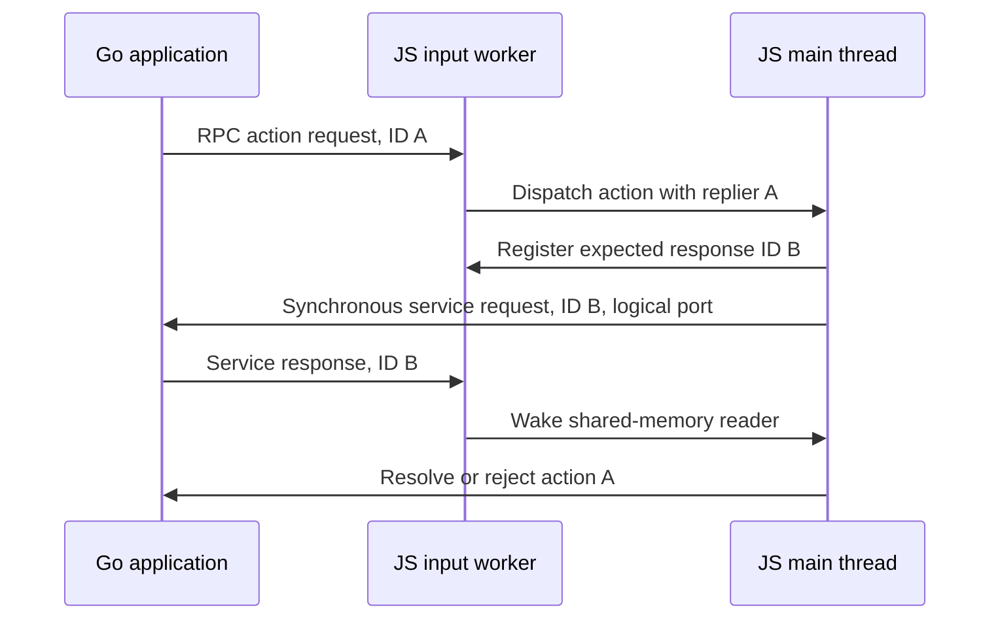

# Cosmos–Agoric VM bridge

The embedded and split-process adapters implement the same JavaScript interface,
defined by the JSDoc types in [agcc-shim.js](../src/agcc-shim.js):

```js
const sender = bridge.start(handleMessage, argv);
const responseJSON = sender.send(goServicePort, messageJSON);
```

`start` accepts a function and a nonempty array of strings including `argv[0]`.
It may be called once. Invalid arguments do not consume that start opportunity.
It returns a sender facet containing only `send`; the bridge itself does not
expose a sender before startup. The embedded adapter starts Go with `argv`. In
split mode, Go is already running and has consumed the command line: `argv` is
validated startup metadata, not a second request to launch a daemon.

The handler receives `(port, messageJSON, replier)` asynchronously on the main JS
thread. It resolves or rejects the replier with a string. Only the first
settlement takes effect. Go actions carry node port 1; JS asserts that value
before dispatching to the chain handler. There is no dynamic inbound routing-port
registration or synthetic daemon-port result.
Logical ports remain meaningful in `send`: they select registered Go services.
`send` validates a positive integer port at most `2**31 - 1` and a string message,
then synchronously waits for and returns a string response.

By default, Go service errors are returned as JSON text such as `{"error":"unregistered
port 7"}` in both adapters, preserving the embedded convention. In split mode,
the adapter converts the RPC error string into that response shape. A response
that already contains application error JSON is passed through unchanged.
Malformed replies and local protocol failures throw instead of being converted
into application responses.

Each call can override service-error handling with
`send(port, messageJSON, { handleError })`. The handler receives the Go error
string and can return replacement response text or throw. Direct Node.js host
calls for storage and SwingStore export updates use
`{ handleError: error => { throw Error(error); } }` so a failed operation cannot
be mistaken for a result. Vat bridge calls retain the default JSON convention;
the vat bridge manager checks the error object and rejects the caller's promise.
The option handles service errors only, not malformed replies or local protocol
failures. A successful response containing application error JSON is still
returned unchanged. Error handlers are not included in persisted downcall
replay records.

## Process and capability boundaries

Embedded mode uses the native addon in
[`golang/cosmos/src/agcosmosdaemon-node.cc`](../../../golang/cosmos/src/agcosmosdaemon-node.cc)
and the C-shared Go library. Its startup and callbacks follow the same interface
as the external adapter. Native reply IDs are private to each replier object;
they are not logical ports and are not exposed as strings with special prefixes.

In split mode, `agd` owns the Go application and launches the VM executable.
The JS entrypoint supplies the external adapter with a synchronous writer,
factories for its input and lifetime-monitor workers, and completion/error
callbacks. The adapter and
configuration selector do not read process environment or acquire filesystem
and worker authority at module-import time.



There is one shared response buffer for synchronous JS-to-Go calls. During an
atomic wait, the JS main thread cannot dispatch another Go action. The supported
nesting is Go action → JS handler → synchronous Go service → JS continues → Go
action reply. A Go service must not synchronously depend on a new JS callback
while JS is waiting for that service. This does not imply that all asynchronous
Go-to-JS actions are globally serialized by the adapter.

## File descriptors and selection

`AGVM_INPUT_FD` is the descriptor on which the VM reads messages from `agd`.
`AGVM_OUTPUT_FD` is the descriptor on which the VM writes messages to `agd`.
Neither variable set selects the native adapter. Otherwise both must be set to
nonempty decimal digit strings. Leading zeros are allowed; signs, whitespace,
fractions, suffixes, hexadecimal notation, and values above `2**31 - 1` are
rejected. This is the nonnegative signed-32-bit descriptor range accepted by the
bridge's Node filesystem interface, not a shell portability guarantee. Numeric
constructor arguments are checked against the same range.

Go's `exec.Cmd.ExtraFiles` starts at descriptor 3. The launcher reserves that slot
for Node parent/child IPC, uses descriptor 4 for VM input and descriptor 5 for VM
output, and supplies those values in the two environment variables. Standard
input, output, and error retain their normal roles. The adapter constructor
takes `(inputFd, outputFd, io)` directly; there is no nested JSON descriptor spec.

The old `AGVM_FROM_AGD` and `AGVM_TO_AGD` names are not part of the new contract.
The Go and JS halves must be updated together; no external VM implementations
require compatibility with the old protocol.

## Split-process wire protocol

Messages are newline-terminated JSON RPC records using Go's `net/rpc/jsonrpc`
format, without a JSON-RPC 2.0 version member. Method names are named constants
in [agcc-agvm.js](../src/agcc-agvm.js), cross-referenced with
[`vm/client.go`](../../../golang/cosmos/vm/client.go). Application messages have
the lower-camel-case Go struct tags `port`, `data`, and `needsReply`:

```json
{"method":"agvm.ReceiveMessage","params":[{"port":1,"data":"action JSON","needsReply":true}],"id":0}
{"method":"agd.ReceiveMessage","params":[{"port":7,"data":"request JSON","needsReply":true}],"id":1}
{"id":1,"result":"response JSON","error":null}
{"id":0,"result":null,"error":"rejected action"}
```

RPC IDs correlate requests and replies within each direction; ID zero is valid.
They are independent of Go logical service ports. Both directions can use the
same numeric ID without confusing an incoming request with a service response.
The input worker routes response records to the synchronous waiter; action
requests reach the main handler. Unrecognized methods and malformed action
records produce diagnostics containing the offending message and expected
method. A synchronous response must have the expected ID, with either a string
result and null error, or a null result and string error. Other response shapes
fail the transport.

`needsReply: false` means no application reply is required. Go's RPC client still
requires an RPC acknowledgement. The external adapter sends the string
`<no-reply-requested>` immediately rather than waiting for application
settlement. The native `ClientCodec` fabricates the same acknowledgement. Later
application settlements of these no-reply messages do not produce another reply.

## RPC ownership and worker protocol

[`rpc-service.js`](../src/helpers/rpc-service.js) runs on the JS main thread. It
owns request IDs, pending inbound IDs, outgoing serialization and newline framing,
request/reply correlation, completion, and shutdown. `agcc-agvm.js` adapts the
application's port/message/replier interface to that service; it does not write
RPC records or allocate correlation IDs independently.

[`agd-input-worker.js`](../src/agd-input-worker.js) acquires the input stream and
uses [`rpc-input.js`](../src/helpers/rpc-input.js) to parse and classify records.
The reader owns the input descriptor, including closing it at completion. Pipes
and sockets use libuv polling rather than a blocking filesystem read, so shutdown
can cancel input while the Go peer keeps its write end open. Regular files use a
filesystem stream. Shared library modules receive their IO from entrypoints.

The typed parent/reader messages are defined in `rpc-service.js`:

| Message | Direction | Meaning |
| --- | --- | --- |
| `INIT_LOOP` | Main → reader | Start once with input FD, shared lifecycle state, and lifetime lease port. |
| `INTERCEPT_ID` | Main → reader | Register one expected response ID and its shared transfer buffer before writing the request. |
| `RECV_OBJ` | Reader → main | Dispatch a parsed inbound request; responses stay in the reader and go to the registered transfer. |
| `STOP_LOOP` | Main → reader | Cancel input after the main thread has entered orderly shutdown with no pending calls. |
| `FINISH_LOOP` | Reader → main | Finish with an explicit error, or null only after orderly shutdown. |
| `WATCH_READER` | Main → monitor | Supply the shared lifecycle state and the other end of the reader's lifetime lease. |

Unknown messages in either direction fail visibly. Duplicate registration,
duplicate pending inbound IDs, unmatched response IDs, malformed JSON, read/write
errors, dispatch errors, and unexpected worker completion fail the service.
Only one synchronous outbound call can be active; overlap is rejected before
another registration or write. Asynchronous inbound requests can settle out of
order. Each reply removes its pending ID; duplicate or late application
settlements do not emit a second response. The reader drops its pending transfer
reference when a response arrives, and failure clears pending state. No explicit
garbage-collection hooks are needed.

## Failure detection and shutdown

Unexpected EOF is a transport failure, including when no call is pending. It
never fabricates a successful response for an outstanding call. Malformed input,
worker errors/exits, and explicit `stop(reason)` reject service completion and
fail outstanding work. Once failed, the service cannot restart.

Main-thread event handlers cannot release a main thread blocked in
`Atomics.wait`. [`rpc-lifecycle.js`](../src/helpers/rpc-lifecycle.js) therefore
publishes failure in shared memory independently of the transfer header. Both
transfer participants inspect this state at every wait, polling at most every
100 ms while blocked. That interval checks failure state; it is not a deadline
for healthy Go requests. Failure publication also has an observable in-progress
state, so a publisher disappearing before it finishes writing a diagnostic
cannot strand a caller.

[`rpc-monitor-worker.js`](../src/rpc-monitor-worker.js) independently watches a
`MessagePort` lease held by the reader. Reader disappearance closes the lease,
allowing the monitor to publish failure while the main thread is blocked. The
reader likewise fails if the monitor disappears. This also covers interruption
in the middle of a response transfer. Normal main-thread `error`, `exit`, and
`messageerror` handlers handle failures when the event loop is available.

Orderly shutdown is explicit. Go calls the reserved `agvm.Shutdown` RPC method;
the main service verifies no outbound call or inbound reply remains pending,
marks shared state as stopping, replies with `<shutdown>`, and sends `STOP_LOOP`.
The reader cancels input and marks the shared state closed before releasing its
lease and sending successful completion. Local `close()` follows the same
shutdown path without a wire acknowledgement and is idempotent. Shutdown with
pending calls fails instead of discarding them. Late replies after failure are
ignored, and completion terminates both workers.

Go bounds the handshake, then closes its pipe and reaps the VM even if the
handshake failed or timed out. A single waiter owns process reaping; shutdown and
the unexpected-exit observer share that result. Existing interrupt/kill grace
periods remain as a fallback and are cancelled when the VM exits. Expected exit
during shutdown is not reported as premature VM exit.

## Follow-on work

The [shared-memory transfer contract](shared-memory-transfer.md) documents F4's
layout, ownership, state machine, generator handoffs, and stale-ID regression.
F5 will repair the remaining UTF-8 codec behavior, including strict final
decoding and incremental encoding into the reusable destination.
