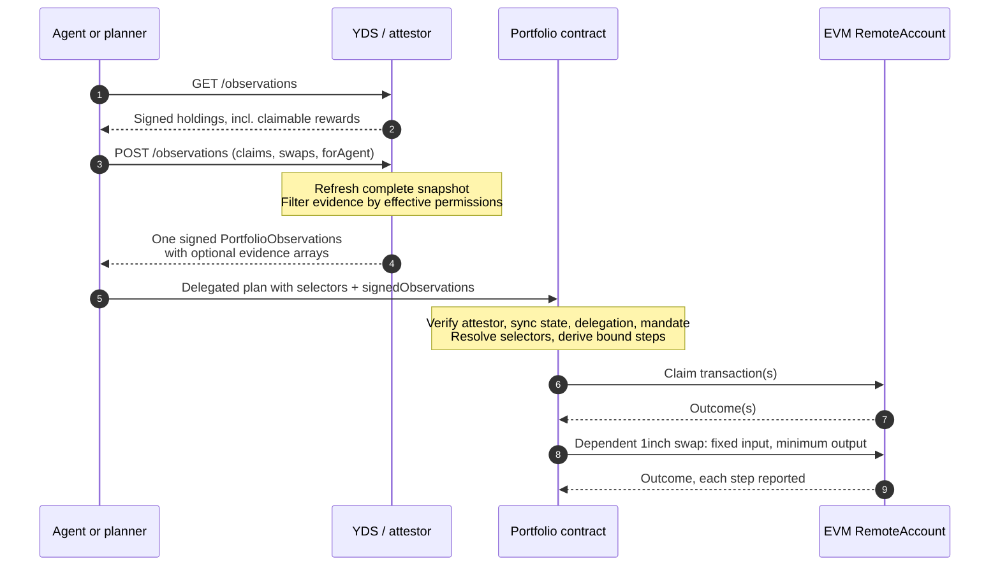

# Agentic reward claims and swaps

A delegated agent (or the planner) may claim protocol rewards into the
portfolio's EVM account and swap eligible reward tokens into that chain's
USDC, in one plan. The agent never supplies what gets executed: the
observation service (YDS, signing as the attestor) supplies signed claim
**evidence** and swap **instructions**, plan steps **select** them by index,
and the contract verifies both before deriving the calls it executes.

This note only sketches the expected operation; contract enforcement lands
with [AGO-1720](https://linear.app/agoric/issue/AGO-1720) and YDS evidence
with [AGO-1719](https://linear.app/agoric/issue/AGO-1719). The full
specification and
its rationale are in the
[implementation design](https://linear.app/agoric/document/agentic-reward-claiming-and-swapping-implementation-design-bd877e47078e)
([AGO-1620](https://linear.app/agoric/issue/AGO-1620)).

## Discovery, then execution



`GET` is discovery only and carries no evidence. The `POST` returns a fresh,
complete snapshot together with the requested evidence, signed **once** in
the same `PortfolioObservations` message. `forAgent` only filters what YDS
returns; it is not authorization.

## Example: Merkl claim, then 1inch swap

The signed observations hold a Merkl entitlement and 1inch swap
instructions for the expected claim proceeds (amounts abbreviated):

```js
observations = {
  holdings: [
    { place: '@Base', kind: 'claimable-reward', tokenId: MORPHO, amount: 2e18 },
    /* … */
  ],
  merklClaims: [
    { accountPlace: '@Base', distributor, tokenId: MORPHO,
      cumulativeAmount: 3e18, claimedAmount: 1e18, proofs: [/* … */] },
  ],
  oneInchSwaps: [
    { accountPlace: '@Base', tokenIn: MORPHO, tokenOut: USDC, amountIn: 2e18,
      quotedAmountOut: 3_000_000n, minAmountOut: 2_940_000n, slippageBps: 200,
      expiresAt, flags: 0n, executor, srcReceiver, data },
  ],
};
plan = {
  flow: [
    { src: '@Base', dest: '@Base', amount: zeroUSDC,
      claimRewards: { protocol: 'merkl', index: 0 } },
    { src: '@Base', dest: '@Base', amount: usdc(2_940_000n),
      swap: { provider: '1inch', index: 0 } },
  ],
  order: [[1, [0]]], // the swap waits for the claim
};
```

- The Merkl claim is account-scoped, so its step stays at `@Base`, like a
  same-chain swap. An Aave or Compound claim instead moves from its
  instrument, e.g. `{ src: 'Aave_Base', dest: '@Base', claimRewards:
  { protocol: 'aave', index: 0 } }` selecting `aaveClaims[0]`.
- The swap's `amount` is the enforced **minimum USDC output**; its exact
  reward-token input is the swap instructions' `amountIn`.
- The swap is budgeted from the claim's expected increment,
  `cumulativeAmount - claimedAmount` = 2e18, hence the ordering.

## Key invariants

- **Claimable vs held.** `claimable-reward` is an unclaimed entitlement,
  attributed to an instrument when known, otherwise to the account `@chain`
  (e.g. unattributed Merkl rewards). It is never spendable inventory;
  `claimed-reward` and `token` holdings are account-scoped.
- **Claims.** Merkl claims are account-scoped and independent of instrument
  holdings. Merkl amounts are cumulative; only the increment is expected, and
  a negative increment is invalid. Aave claims all rewards of the token at
  execution time (`claimRewardsToSelf(…, MAX_UINT256, token)`); Compound
  claims whatever is owed. Expected amounts are estimates, never minimums.
- **Optimistic execution.** A claim may pay less than expected, or fail
  (e.g. a Merkle root update makes a proof stale). A dependent fixed-input
  swap then fails safely; earlier successful steps stand, and leftover reward
  tokens are left for a later plan with fresh evidence.
- **Swap eligibility.** There is no swap permission yet: swapping is implied
  by `claimRewards`, so a swap's `tokenIn` must be a reward token on the
  swap's chain. Its input is budgeted from a signed `claimed-reward` holding
  of that token at the account, plus the expected increments of claims of
  that token selected earlier in the same plan; a `claimable-reward` holding
  only counts once its claim is in the plan, ordered before the swap. Uses
  are accounted across all of the plan's swaps, without double-counting.
  This applies in addition to the denyset below.
- **Token authorization.** Swap instructions are token-neutral, but the
  contract initially only swaps reward tokens into its configured USDC,
  approving only the swap's `amountIn` of `tokenIn` for its configured
  router, with output to the portfolio's own account.
- **Contract denyset.** Independently of YDS classification, the contract
  rejects any swap whose `tokenIn` is a principal or cash token from its own
  configuration (USDC, Aave aTokens, Compound Comet tokens, vault share
  tokens…), failing closed if that configuration is unavailable.
- **Minimum output.** `slippageBps` may not exceed
  `MAX_REWARD_SWAP_SLIPPAGE_BPS` (2%), and `minAmountOut` must be at least
  `getMinAmountOutForSlippage(quotedAmountOut, slippageBps)`. Signed 1inch
  `flags` must be `0n`: partial fills would not guarantee the minimum.
- **Permissions.** `getEffectivePortfolioPermissions` inherits stepwise,
  allocation → rebalance → claimRewards: an absent permission inherits its
  parent's effective value, an explicit `false` blocks inheritance (so
  `{ allocation: true, rebalance: false }` cannot claim), and an explicit
  `true` is an independent grant. `claimRewards` covers claiming and swapping
  eligible rewards, nothing else.
- **Validation boundary.** Only the contract authorizes: it verifies the
  signed observations and the delegation, resolves selectors against the
  signed evidence, never trusts proofs or route data from the plan itself,
  and builds the bound steps it executes. YDS filtering and quoting are not
  authorization.

## API declarations

In `@agoric/portfolio-api`:

- Claim evidence and swap instructions (`SelectableObservations`) and
  selectors (`ClaimRewardsSelector`, `SwapSelector`):
  [types.ts](../../portfolio-api/src/types.ts)
- Signed schema and converters, `getMerklClaimExpectedAmount`:
  [observation-messages.ts](../../portfolio-api/src/observation-messages.ts)
- Shapes: [type-guards.ts](../../portfolio-api/src/type-guards.ts)
- `getEffectivePortfolioPermissions`:
  [portfolio-permissions.ts](../../portfolio-api/src/portfolio-permissions.ts)
- `MAX_REWARD_SWAP_SLIPPAGE_BPS`, `getMinAmountOutForSlippage`:
  [reward-swaps.ts](../../portfolio-api/src/reward-swaps.ts)
