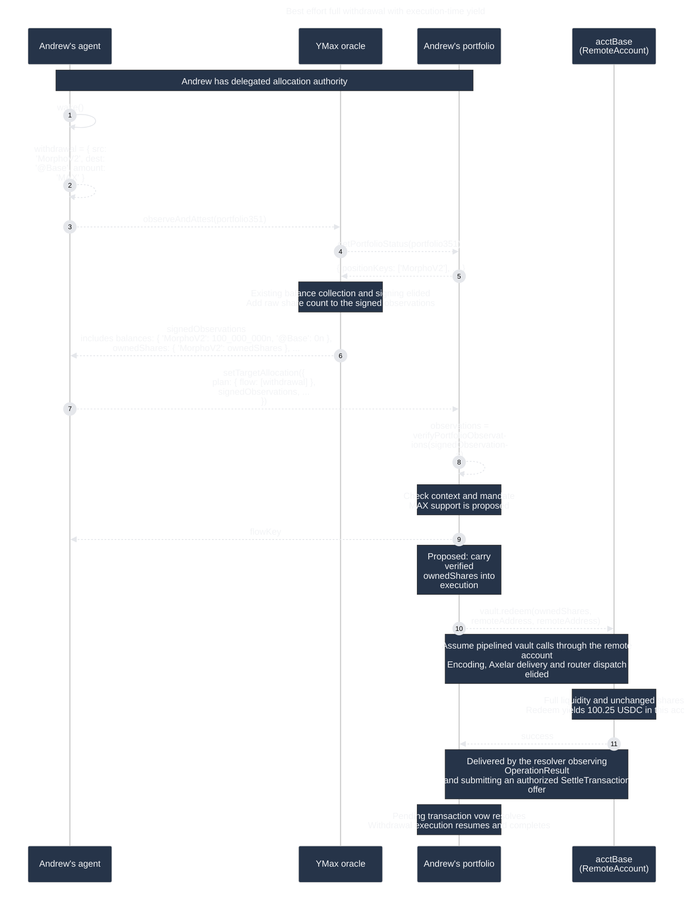

# Exit a position completely

## Withdraw accrued value into the chain account

Andrew wants to exit his Morpho position and hold the proceeds as USDC in his
Base account. He has delegated planning to his agent, as in the
[agent-driven planning journey](agentic-planning.md). The agent observes a
100 USDC position and plans a full withdrawal. Yield raises its value to
100.25 USDC before execution.

This is a proposed actor simulation for
[AGO-1575](https://linear.app/agoric/issue/AGO-1575/design-for-exit-position-completely).



1. **Wake the agent.** Andrew has already granted allocation authority. The
   simulation driver constructs the actors and invokes only `wake()`; later
   messages arise from actor behavior.

2. **Construct the withdrawal.** `MorphoV2` abbreviates
   `ERC4626_morphoGauntletUsdcPrimeV2_Base`. The movement requests a best effort
   full withdrawal into `@Base`; `'MAX'` permits residuals. It does not close
   the portfolio, remove its target, or withdraw to Andrew's wallet. Expand the
   alias to the real instrument ID when serializing the plan.

3. **Collect observations.** The agent calls the existing
   `observeAndAttest(portfolio351)` path from the
   [agent-driven planning journey](agentic-planning.md). No additional
   observation service is introduced.

4. **Identify the portfolio's places.** The oracle reads portfolio status
   through its read capability. It has no portfolio execution or resolver
   authority.

5. **Return portfolio status.** Position keys and account information identify
   the balances to collect. The `...` elides the existing sync-state and other
   status fields.

6. **Return signed observations, including shares.** Extend observations with
   `ownedShares: Partial<Record<InstrumentId, bigint>>`, alongside the existing
   USDC-valued balances and instrument TVLs. Shares are raw vault-token units;
   missing data is distinct from an observed zero.

   Reuse the existing Morpho collector. YDS's
   [`getMorphoBalance`](../../../../ymax-web/yds/src/utils/alchemy-kit.ts) reads
   `balanceOf`, then `convertToAssets` at the same block. Its batched equivalent
   does the same in two multicalls. Both currently return USDC balance and
   block height, discarding the raw shares. Retain that count and expose it in
   the observations the oracle signs. Extend types, Shapes, the signed schema,
   and encoding/decoding together. Collection and signing mechanics are elided
   in the diagram.

7. **Submit the plan and observations.** The agent uses
   [`delegationClient.setTargetAllocation`](../src/delegation.exo.ts). Its
   request includes `syncState`, `targetAllocation`, `plan`, and
   `signedObservations`, plus optional `agentMemo`. The diagram's `...` elides
   those other fields; the movement itself is wrapped in `plan.flow`.

   Existing numeric amounts remain ERTP `NatAmount` records such as
   `{ brand: usdcBrand, value: 100_000_000n }`. Accepting `'MAX'` only for
   protocol withdrawals is proposed behavior; transfers, bridges, deposits,
   and downstream steps retain existing amount semantics.

8. **Verify and validate.** The contract verifies the signed observations,
   checks their portfolio and sync-state context, and enforces the delegation
   and mandate. Adding a signed share count does not grant additional
   authority. How allocation validation bounds variable withdrawal proceeds
   remains a design question; the existing agentic simulation's
   `allocationAfter` assumes fixed `amount.value` values.

9. **Return the flow key.** The contract allocates the key. This reply precedes
   execution completion and does not prove that the position is empty.

10. **Redeem through the RemoteAccount.** Assume the contract can pipeline vault
    calls through its account capability. Carry the verified share count into
    execution and call `redeem(ownedShares, remoteAddress, remoteAddress)`.
    Today, observations are used for plan validation and are not forwarded to
    `executePlan`; that internal handoff is a proposed implementation change.
    Encoding, Axelar delivery, and authorized router dispatch are elided.

    `acctBase` is the per-portfolio chain account in the system map;
    `RemoteAccount` is its concrete EVM counterpart. The vault sees that account
    as caller, share owner, and USDC receiver. The relevant Morpho ABI is:

    ```solidity
    function redeem(uint256 shares, address receiver, address onBehalf)
        external returns (uint256 assets);
    ```

    YMax's current [`erc4626ABI`](../src/interfaces/erc4626.ts) has only
    `deposit` and `withdraw`; add `redeem` for this route. Morpho publishes the
    full [Vault V2 interface](https://github.com/morpho-org/vault-v2/blob/main/src/interfaces/IVaultV2.sol).
    The example vault address in
    [`axelar-configs.js`](../../portfolio-deploy/src/axelar-configs.js) is
    `0x050cE30b927Da55177A4914EC73480238BAD56f0`; this is a repository reference,
    not live bytecode verification.

    With unchanged shares and sufficient liquidity, redemption captures the
    accrued yield: 100.25 USDC instead of the observed 100 USDC. Changed shares
    can leave a residual or cause failure. Under the scope proposal below, the
    planning agent handles limited liquidity; wrappers execute the requested
    operation and report failures. Vault V2's `maxWithdraw` and `maxRedeem` always return zero,
    unlike the older MetaMorpho implementation's liquidity-aware maxima. See
    [Morpho's version-specific documentation](https://docs.morpho.org/developers/contracts/morpho-vaults-v2/).

11. **Confirm execution.** The resolver observes the router's matching
    `OperationResult` event and submits an authorized `SettleTransaction`
    offer. The contract-side `settleTransaction` fulfills the pending
    transaction vow, allowing withdrawal execution to complete. The note beside
    the arrow abstracts this delivery. See
    [`resolver.ts`](../../../services/ymax-planner/src/resolver.ts) and
    [`resolver.exo.ts`](../src/resolver/resolver.exo.ts).

    No post-execution balance read is required for completion. Later agent
    observations can refresh shares and cash. In this scenario, successful
    redemption of all unchanged shares leaves zero vault shares. Fixed
    downstream movements use their original amounts, with
    surplus cash available for a later plan. No automatic sweep or replanning
    is introduced.

## Proposed scope adjustment

AGO-1575 currently requires wrappers to make a reasonable partial withdrawal
when liquidity prevents a full exit, without failing solely because the
position cannot be fully closed. This design proposes assigning liquidity
assessment and recovery to the planning agent instead. The proposal is pending;
it differs from the issue's current requirements.

The agent chooses `'MAX'` when a full exit appears feasible or a numeric amount
when liquidity is limited. If execution fails because conditions changed, the
agent can refresh observations and submit a revised plan. Wrappers execute the
requested operation without discovering liquidity, silently reducing the
withdrawal, or converting a revert into success. Existing numeric behavior,
empty-position no-op behavior, and failure/recovery reporting remain in scope.

## Simulation work

Following the [actor simulation skill](../../../.agents/skills/sequence-diagram-actor-sim/SKILL.md),
add `test/exit-position-completely-sim.test.ts` using
[`sequence-diagram-actor-sim.ts`](../tools/sequence-diagram-actor-sim.ts).
Read this diagram as test input and compare its causal arrows. Separately
assert fixture balances, shares, and transaction counts: full exit after
yield, agent-selected numeric withdrawal under limited liquidity, empty
position, missing share data, changed shares, genuine failure, unchanged
numeric withdrawals, and fixed downstream amounts. Cover refreshed observations
and an agent's revised plan after failure, rather than wrapper-side automatic
partial withdrawal. An empty position succeeds without a funds-moving
transaction. Matching arrows alone does not prove ABI encoding, accounting, or
recovery; wrapper and flow tests must cover those paths across the supported
protocols and versions.
