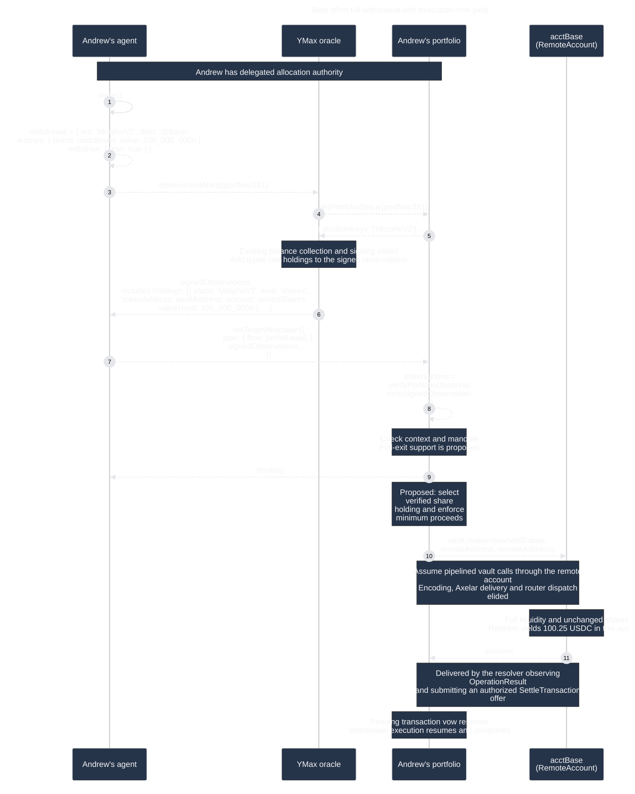

# Exit a position completely

## Withdraw accrued value into the chain account

Andrew wants to exit his Morpho position and hold the proceeds as USDC in his
Base account. He has delegated planning to his agent, as in the
[agent-driven planning journey](agentic-planning.md). The agent observes a
100 USDC position and plans a full withdrawal. Yield raises its value to
100.25 USDC before execution.

This is a proposed actor simulation for
[AGO-1575](https://linear.app/agoric/issue/AGO-1575/design-for-exit-position-completely).



1. **Wake the agent.** Andrew has already granted allocation authority. The
   simulation driver constructs the actors and invokes only `wake()`; later
   messages arise from actor behavior.

2. **Construct the withdrawal.** `MorphoV2` abbreviates
   `ERC4626_morphoGauntletUsdcPrimeV2_Base`. The movement's
   `withdraw.max` requests a full withdrawal into `@Base`. It does not close the portfolio, remove its
   target, or withdraw to Andrew's wallet. Expand the alias to the real
   instrument ID when serializing the plan.

3. **Collect observations.** The agent calls the existing
   `observeAndAttest(portfolio351)` path from the
   [agent-driven planning journey](agentic-planning.md). No additional
   observation service is introduced.

4. **Identify the portfolio's places.** The oracle reads portfolio status
   through its read capability. It has no portfolio execution or resolver
   authority.

5. **Return portfolio status.** Position keys and account information identify
   the balances to collect. The `...` elides the existing sync-state and other
   status fields.

6. **Return signed observations with typed raw holdings.** The oracle reports
   the position's vault address, raw `shares` quantity, and observed USD value
   in signed observations. The contract will use that share quantity for
   redemption. See the API's
   [`TypedHoldingDetail`](../../portfolio-api/src/types.ts) JSDoc for holding
   identities, kinds, units, signed representation, and legacy compatibility.

   The existing Morpho collector reads `balanceOf`, then `convertToAssets` at
   the same block; it retains the raw shares alongside valuation. See YDS's
   [`getMorphoBalance`](../../../../ymax-web/yds/src/utils/alchemy-kit.ts).

7. **Submit the plan and observations.** The agent uses
   [`delegationClient.setTargetAllocation`](../src/delegation.exo.ts). Its
   request includes `syncState`, `targetAllocation`, `plan`, and
   `signedObservations`, plus optional `agentMemo`. The diagram's `...` elides
   those other fields; the movement itself is wrapped in `plan.flow`.

   In this scenario, `withdraw: { max: true }` requests all shares from the
   source position, and the movement's `amount` is the minimum USDC received
   at `@Base`. The request uses the authenticated share holding to determine
   redemption quantity. See [`WithdrawParams`](../../portfolio-api/src/types.ts)
   for the option semantics; the
   [principal-withdrawal simulation TODO](../test/exit-position-completely-sim.test.ts)
   describes a separate scenario that requests an exact principal amount.

8. **Verify and validate.** The contract verifies the signed observations,
   checks their portfolio and sync-state context, and enforces the delegation
   and mandate. The portfolio contract relies on the attestor for accurate
   observations when checking the mandate and constructing the transaction:
   the verified `shares` holding determines the `redeem` transaction's share
   argument. The delegated plan supplies
   the intent to withdraw all from a specific position; observations do not
   authorize a new operation or destination. Binding observations to the
   portfolio and sync state, authenticating the signer, and checking freshness
   are therefore also safeguards on transaction construction. Allocation
   validation projects the attested USDC balance for maximum withdrawals and
   checks that it covers the requested minimum. That snapshot is neither the
   redemption quantity nor an execution-time guarantee. Fixed downstream
   amounts still undergo funding and allocation checks.

   Withdrawal parameters are additive: the API and contract Shapes accept them
   before execution implements their semantics (AGO-1614). The current contract
   ignores the options during allocation analysis and executes `amount` exactly.
   This is a reasonable fallback for a request whose destination amount is a
   minimum; `amount: 0` may fail validation. Acceptance or successful execution
   does not establish that a maximum withdrawal or source-token request was
   honored.

   Implementing the options will require authenticated `shares` or `principal`
   holdings to resolve source-token identity and value raw quantities. A USDC
   valuation alone does not establish that identity. The target behavior must
   distinguish raw source units from destination micro-USDC.

9. **Return the flow key.** The contract allocates the key. This reply precedes
   execution completion and does not prove that the position is empty.

10. **Redeem through the RemoteAccount.** Assume the contract can pipeline vault
    calls through its account capability. Select the authenticated `shares` entry
    for the source instrument and configured vault address, and use its raw
    `amount` as `ownedShares` in
    `redeem(ownedShares, remoteAddress, remoteAddress)`.
    Today, observations are used for plan validation and are not forwarded to
    `executePlan`; that internal handoff is a proposed implementation change.
    Execution must also enforce the requested minimum proceeds. If a protocol
    cannot enforce a nonzero minimum, add an appropriate atomic guard (see
    AGO-643) or reject that request before sending a funds-moving transaction;
    an attested valuation alone is insufficient. Observed empty shares are a
    no-op only when the minimum is zero. A positive minimum on an empty position
    fails. Encoding, Axelar delivery, and authorized router dispatch are elided.

    `acctBase` is the per-portfolio chain account in the system map;
    `RemoteAccount` is its concrete EVM counterpart. The vault sees that account
    as caller, share owner, and USDC receiver. The relevant Morpho ABI is:

    ```solidity
    function redeem(uint256 shares, address receiver, address onBehalf)
        external returns (uint256 assets);
    ```

    YMax's current [`erc4626ABI`](../src/interfaces/erc4626.ts) has only
    `deposit` and `withdraw`; add `redeem` for this route. Morpho publishes the
    full [Vault V2 interface](https://github.com/morpho-org/vault-v2/blob/main/src/interfaces/IVaultV2.sol).
    The example vault address in
    [`axelar-configs.js`](../../portfolio-deploy/src/axelar-configs.js) is
    `0x050cE30b927Da55177A4914EC73480238BAD56f0`; this is a repository reference,
    not live bytecode verification.

    With unchanged shares and sufficient liquidity, redemption captures the
    accrued yield: 100.25 USDC instead of the observed 100 USDC. Changed shares
    can leave a residual or cause failure. Under the agreed scope below, the
    planning agent handles limited liquidity; wrappers execute the requested
    operation and report failures. Vault V2's `maxWithdraw` and `maxRedeem` always return zero,
    unlike the older MetaMorpho implementation's liquidity-aware maxima. See
    [Morpho's version-specific documentation](https://docs.morpho.org/developers/contracts/morpho-vaults-v2/).

11. **Confirm execution.** The resolver observes the router's matching
    `OperationResult` event and submits an authorized `SettleTransaction`
    offer. The contract-side `settleTransaction` fulfills the pending
    transaction vow, allowing withdrawal execution to complete. The note beside
    the arrow abstracts this delivery. See
    [`resolver.ts`](../../../services/ymax-planner/src/resolver.ts) and
    [`resolver.exo.ts`](../src/resolver/resolver.exo.ts).

    No post-execution balance read is required for completion. Later agent
    observations can refresh shares and cash. In this scenario, successful
    redemption of all unchanged shares leaves zero vault shares. Fixed
    downstream movements use their original amounts, with
    surplus cash available for a later plan. No automatic sweep or replanning
    is introduced.

## Liquidity assessment and recovery

The planning agent assesses liquidity and selects a maximum withdrawal when a
full exit appears feasible, or an exact numeric withdrawal when liquidity is
limited. Wrappers execute that request without silently reducing the amount or
converting a revert into success. A failure due to changed conditions uses the
existing flow failure/recovery path; the agent refreshes observations and
submits a revised plan. No exhaustive liquidity discovery, automatic partial
withdrawal, sweep, or replanning is introduced in the wrapper.

Successful redemption of all unchanged observed shares captures accrued yield.
Changed shares can leave a residual or cause failure. Success does not prove a
zero remaining position. A zero position with a zero minimum succeeds without
a funds-moving transaction. Genuine errors and unmet minimums remain failures.

## Simulation work

Following the [actor simulation skill](../../../.agents/skills/sequence-diagram-actor-sim/SKILL.md),
implement the scenarios in
[`test/exit-position-completely-sim.test.ts`](../test/exit-position-completely-sim.test.ts) using
[`sequence-diagram-actor-sim.ts`](../tools/sequence-diagram-actor-sim.ts).
Read this diagram as test input and compare its causal arrows. Separately
assert fixture balances, shares, and transaction counts: full exit after
yield, agent-selected numeric withdrawal under limited liquidity, empty
position with zero and positive minimums, missing share data, changed shares,
unmet minimums, genuine failure, unchanged numeric withdrawals, and fixed downstream amounts. Cover refreshed observations
and an agent's revised plan after failure, rather than wrapper-side automatic
partial withdrawal. An empty position with a zero minimum succeeds without a
funds-moving transaction. Matching arrows alone does not prove ABI encoding, accounting, or
recovery; wrapper and flow tests must cover those paths across the supported
protocols and versions.
