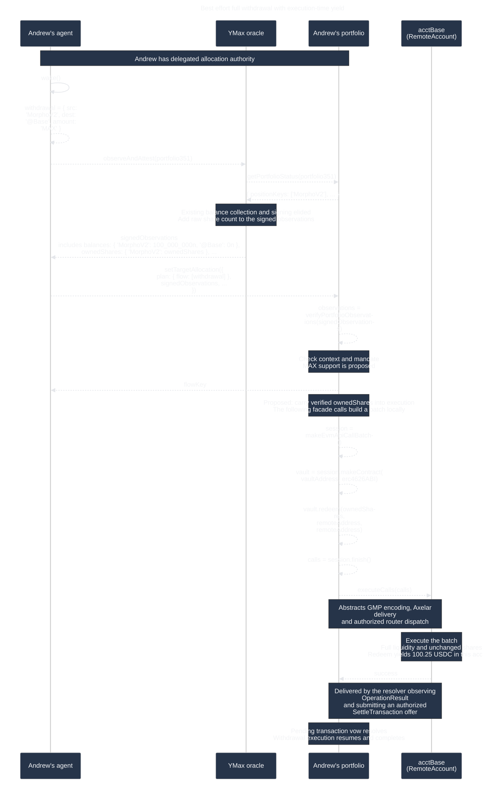

# Exit a position completely

## Withdraw accrued value into the chain account



`MorphoV2` abbreviates `ERC4626_morphoGauntletUsdcPrimeV2_Base` throughout the
journey; expand it to the full instrument ID when serializing a real plan.
The `...` elides the other required submission fields, detailed below.

Andrew wants to exit his Morpho position and hold the proceeds as USDC in his
Base account. He has delegated planning to his agent, as in the
[agent-driven planning journey](agentic-planning.md). The agent observes a
100 USDC position and constructs the withdrawal plan. Yield raises its value
to 100.25 USDC before execution. The intended withdrawal redeems all owned
shares rather than requesting the stale 100 USDC estimate. The resolver reports
confirmed execution to the contract. A successful execution receipt alone
does not establish that the position is empty.

This is a proposed actor simulation for
[AGO-1575](https://linear.app/agoric/issue/AGO-1575/design-for-exit-position-completely).
`'MAX'` means a best effort protocol withdrawal, not a guarantee of zero dust.
It does not close the portfolio, remove a target, prevent later deposits, or
withdraw funds to the owner. In the system map, `acctBase` is a per-portfolio
chain account; `RemoteAccount` is its concrete EVM counterpart.

Delegation is a fixture prerequisite. Andrew's agent collects signed
observations from the YMax oracle before submitting its own plan through its
portfolio-specific delegation client, following `agentic-planning.md`. The
contract allocates and returns the flow key after accepting the request. The
method exists today; accepting `amount: 'MAX'` is a proposed extension.

## Exact submission methods and arguments

Andrew's agent uses
[`delegationClient.setTargetAllocation`](../src/delegation.exo.ts):

```ts
setTargetAllocation({
  syncState,           // { policyVersion: number, rebalanceCount: number }
  targetAllocation,    // TargetAllocation
  plan,               // optional FundsFlowPlan
  signedObservations, // required exactly when plan is present
  agentMemo,          // optional string
}): Promise<FlowKey>;
```

That client authenticates the delegation, verifies signed observations, and
calls `portfolioAccess.submitTargetAllocation(client, agentId,
allocationParams, verifiedObservations)`. Its returned `FlowKey` also precedes
completion. The injected `executePlan(seat, offerArgs, kit, flowDetail?, startedFlow?,
config?, options?)` in `portfolio.exo.ts` is an internal flow function, not an
agent entry point.

The withdrawal is a movement record; the submission wraps it in `plan.flow`:

```ts
const withdrawal = { src: 'MorphoV2', dest: '@Base', amount: 'MAX' };
const plan = { flow: [withdrawal] };
```

Existing numeric `MovementDesc.amount` values remain ERTP `NatAmount` records
such as `{ brand: usdcBrand, value: 100_000_000n }`, not bare JavaScript numbers.
An optional `fee` is also a branded amount.

## Include owned shares in observations

Extend the observations already collected by
`observeAndAttest(portfolio351)` with `ownedShares`, keyed by instrument ID:

```ts
ownedShares: Partial<Record<InstrumentId, bigint>>;
```

The YMax oracle reads `vault.balanceOf(remoteAddress)` and includes that count
in the observations it signs and returns to Andrew's agent. The agent submits
those same signed observations with its plan. The contract verifies them as
usual. This adds a fact to the existing observation path, not another
observation service or a separate agent assertion.

Reuse the existing Morpho balance collector rather than introduce a new
valuation path. In this checkout, YDS's
[`getMorphoBalance`](../../../../ymax-web/yds/src/utils/alchemy-kit.ts) reads
`balanceOf`, then `convertToAssets` at the same block. Its batched
`getPositionBalances` does the same in two multicalls. Both currently return
the USDC balance and block height, discarding the raw share count. The proposed
change retains and exposes that count through the observation path. The
diagram elides the existing valuation work and highlights the added share data.

Shares are raw vault-token units, not the position's micro-USDC valuation.
Missing share data must remain distinct from an observed zero balance. Extend
the observation types, Shapes, signed schema and encoding/decoding together so
the count is covered by the signature.

For execution, carry the verified count through to the withdrawal call builder
and encode `redeem(ownedShares, remoteAddress, remoteAddress)`. This is a
proposed implementation change: today, verified observations are used by plan
validation and are not forwarded to `executePlan`. The exact internal handoff
still needs implementation design; it does not require another observation
collection step.

The ideal fixture keeps the observed share count unchanged while its asset
value grows from 100 to 100.25 USDC. Redeeming that count captures the yield.
This uses observation-time shares, not an atomic execution-time balance query.
If shares change before execution, the encoded redemption can leave a residual
or fail; existing failure handling still applies. Include those cases in tests.
This proposal does not by itself solve liquidity-limited withdrawals.

## Exact Morpho vault interface

The example selects `ERC4626_morphoGauntletUsdcPrimeV2_Base`, configured as
`0x050cE30b927Da55177A4914EC73480238BAD56f0` in
[`axelar-configs.js`](../../portfolio-deploy/src/axelar-configs.js).
This is a repository configuration reference, not live verification of the
address's deployed bytecode or full ABI.

Morpho publishes its complete Vault V2 interface as
[`IVaultV2`](https://github.com/morpho-org/vault-v2/blob/main/src/interfaces/IVaultV2.sol),
inheriting
[`IERC4626`](https://github.com/morpho-org/vault-v2/blob/main/src/interfaces/IERC4626.sol),
[`IERC20`](https://github.com/morpho-org/vault-v2/blob/main/src/interfaces/IERC20.sol)
and `IERC2612`. The exact function signatures relevant here are:

```solidity
function balanceOf(address account) external view returns (uint256);
function asset() external view returns (address);
function convertToAssets(uint256 shares) external view returns (uint256 assets);
function previewRedeem(uint256 shares) external view returns (uint256 assets);
function maxWithdraw(address onBehalf) external view returns (uint256 assets);
function maxRedeem(address onBehalf) external view returns (uint256 shares);
function withdraw(uint256 assets, address receiver, address onBehalf)
    external returns (uint256 shares);
function redeem(uint256 shares, address receiver, address onBehalf)
    external returns (uint256 assets);
```

`redeem` takes a numeric share count and returns underlying assets. It does not
accept the string `'MAX'`. `withdraw` takes an asset count and returns shares
burned. `balanceOf` on the vault reads shares; `balanceOf` on the USDC token
reads USDC. The former `getUSDCBalance()` account arrow was a placeholder.

YMax's current [`erc4626ABI`](../src/interfaces/erc4626.ts) contains only
`deposit(uint256,address) returns (uint256 shares)` and
`withdraw(uint256,address,address) returns (uint256 shares)`, both nonpayable.
It is an ABI subset. `ERC4626Protocol.withdraw` currently builds
`vault.withdraw(amount.value, remoteAddress, remoteAddress)`. Share redemption
requires adding `redeem` to that ABI subset.

Vault version matters: Morpho documents that Vault V2's `maxWithdraw` and
`maxRedeem` always return zero, so they cannot serve as liquidity discovery.
See [Vault V2 documentation](https://docs.morpho.org/developers/contracts/morpho-vaults-v2/).
The older [MetaMorpho implementation](https://github.com/morpho-org/metamorpho/blob/main/src/MetaMorpho.sol)
instead calculates liquidity-aware maxima. Do not apply one version's max
semantics to every Morpho instrument.

## Redeem the observed shares

The routed `RemoteAccount` entry point is
`executeCalls(ContractCall[] calls) external payable`, where each call is
`{ address target, bytes data, uint192 value, uint64 gasLimit }`.
Only a factory-authorized router may invoke it.

`executeCalls` performs ordinary calls with pre-encoded arguments and discards
successful return data. Once a numeric share count reaches the call builder,
it can be encoded directly in `redeem` calldata without return-value chaining.
The proposed flow-input extension carries it from verified observations. The
vault sees the RemoteAccount as caller, owner and receiver.

The diagram keeps four actors: agent, oracle, portfolio and RemoteAccount.
The portfolio's self-calls use the existing
[`evm-facade`](../src/evm-facade.ts) batch-building style. `vault` is a local
call-recording facade, not a separate actor or an RPC connection. With the
proposed `redeem` ABI addition, it records a redemption using the verified
share count.

The portfolio-to-account `executeCalls(calls)` arrow abstracts the encoding and
delivery performed through `sendGMPContractCall`. The facade's `finish()`
returns call descriptions; GMP encoding turns them into the account's ABI
payload. The actual EVM caller is the authorized router. Router, vault and
token mechanics are elided, as are resolver delivery mechanics on the return.

The RemoteAccount's EVM call returns to the router. The router emits
`OperationResult`; the off-chain resolver observes and validates the matching
event, then submits an authorized `SettleTransaction` offer. The contract-side
`settleTransaction` fulfills the pending transaction vow, allowing execution
to resume. See [`resolver.ts`](../../../services/ymax-planner/src/resolver.ts)
and [`resolver.exo.ts`](../src/resolver/resolver.exo.ts).

No post-execution balance read is required for this completion path. A later
agent observation cycle may refresh shares and cash through the off-chain
oracle. That is separate from the contract completing this withdrawal. The
simulation can inspect fixture state to assert zero shares and 100.25 USDC
cash without adding production read operations to the journey.

## Simulation boundaries

Use the repository's
[sequence-diagram actor simulation skill](../../../.agents/skills/sequence-diagram-actor-sim/SKILL.md).
The test driver constructs actors and invokes only `wake()`. Subsequent calls
and replies must arise from actor behavior. Initial observations, execution-time
shares/value, available liquidity, and failures are fixture inputs rather than
hard-coded facts in the actor factories.

Give Andrew's agent its portfolio-specific delegation client. The oracle has
only status/balance-read and attestation capabilities, with no execution or
resolver authority. The portfolio builds the batch and sends it through its
existing GMP capability. Model delivery to the account and return confirmation
at the diagram's abstraction level, without adding transport actors. Calldata
must be derived from the oracle's verified share count. Passing that count into
execution is proposed behavior to implement and test.

The first simulation should exercise the withdrawal only. Add a separate
scenario with a prewritten numeric downstream movement: after withdrawing
100.25 USDC, move 50 USDC and observe 50.25 USDC left in the chain account.
No downstream step accepts `'MAX'`, and no automatic sweep or replanning occurs.

## Cases to exercise

| Case | Expected result |
| --- | --- |
| Full redemption after yield accrues | 100.25 USDC in chain cash, zero shares |
| Liquidity permits only 60 USDC | Successful partial withdrawal, 60 USDC cash and observable residual worth 40.25 USDC in this fixture |
| Already empty position | Success without a funds-moving transaction |
| Missing share observation | Reject rather than interpret as an empty position |
| Shares change after observation | Expose residual or existing execution failure, never fabricate a complete exit |
| Genuine execution failure | Existing failure/recovery behavior, no fabricated success |
| Wrapper without practical full-exit primitive | Reasonable withdrawal using latest known balance, observable residual allowed |
| Fixed downstream amount exceeds actual proceeds | Existing downstream failure/recovery behavior |
| Existing numeric withdrawal | Existing amount behavior preserved |

Liquidity handling needs an explicit reasonable partial-exit strategy. A native
full-exit call alone may fail when liquidity is insufficient; the simulation
must not conceal that by treating an arbitrary revert as success. Aave,
Compound, Morpho/ERC4626, Beefy, and USDN coverage must follow the actual
supported protocol/version wrappers. Protocol-specific tests must establish
which native primitive or observed-balance fallback each wrapper uses.

## From diagram to executable test

Add `test/exit-position-completely-sim.test.ts` beside the existing
[`agentic-planning-sim.test.ts`](../test/agentic-planning-sim.test.ts), reusing
[`sequence-diagram-actor-sim.ts`](../tools/sequence-diagram-actor-sim.ts).
Read this document as test input and select the Mermaid fence under
“Withdraw accrued value into the chain account”. Compare the causal arrow
trace, then assert independently on cash, shares, residuals, and transaction
counts. Exercise the EVM segment with calldata derived from the verified share
count. Matching arrows alone does not establish accounting correctness or integration.

The existing agentic simulation's `allocationAfter` subtracts fixed
`amount.value` values. Do not extend it by replacing `'MAX'` with a stale
estimate and then treating that estimate as actual execution proceeds. How
delegated target-allocation validation bounds a variable withdrawal remains a
design question before connecting this scenario to that submission path.

Current production `MovementDesc.amount` is a `NatAmount` in
[`portfolio-api/src/types.ts`](../../portfolio-api/src/types.ts), and the
[`EVM wrappers`](../src/pos-evm.flows.ts) use numeric `amount.value` withdrawals.
This note does not settle the sentinel's shared wire representation. Follow-up
validation and serialization tests must accept `'MAX'` only for protocol
withdrawals and reject it for deposits, transfers, bridges, and other steps.
The actor simulation explores the proposed interaction; wrapper and flow tests
must separately verify actual ABI calls, confirmation, accounting, and recovery.
